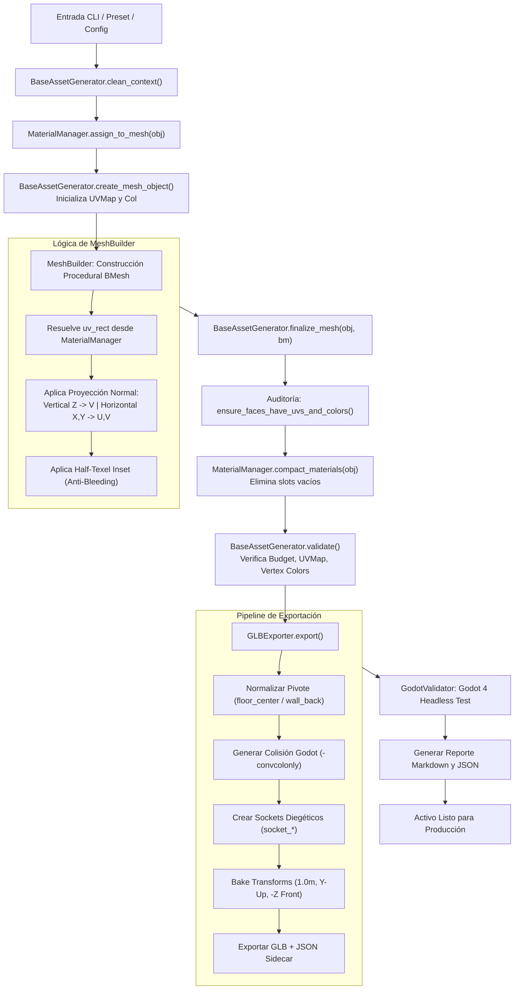

# Sistema de Generación Procedural de Assets 3D (PSX Low-Poly) — Below Nominal

Herramienta de generación procedural de modelos 3D con estética retro PS1 / PSX low-poly, desarrollada para el survival horror espacial **Below Nominal**. El sistema produce geometría optimizada, mallas de colisión nativas para Godot 4, sockets de acople, paletas temáticas PBR y mapeo automático a un atlas de texturas erosionadas de 256×256 píxeles.

[](https://codespaces.new/FrancisCuarto/MODELCODER)
[](https://modelcoder.vercel.app/)

> **🚀 Inicio Inmediato en 1-Clic (Sin Configuración Manual):**
> - **En la Nube (Gratis):** Haz clic en el botón de **Open in GitHub Codespaces** para abrir un Visual Studio Code completo en tu navegador con Python, Blender y la web listos para generar.
> - **En Windows (Local):** Haz doble clic en [`INICIAR_MODELCODER.bat`](file:///d:/MODELCODER/INICIAR_MODELCODER.bat) para autodetectar Blender, instalar dependencias y levantar el worker en segundo plano.

---

## 📑 Tabla de Contenidos

1. [Arquitectura del Sistema](#-arquitectura-del-sistema)
2. [Requisitos y Dependencias](#-requisitos-y-dependencias)
3. [Flujo de Generación (Diagrama)](#-flujo-de-generación-diagrama)
4. [Cómo Ejecutar el Generador](#-cómo-ejecutar-el-generador)
5. [Familias Disponibles](#-familias-disponibles-44-familias)
6. [Cómo Crear una Familia Nueva de Modelos](#-cómo-crear-una-familia-nueva-de-modelos)
7. [Cómo Agregar Parámetros y Componentes](#-cómo-agregar-parámetros-y-componentes)
8. [Cómo Crear y Usar Presets](#-cómo-crear-y-usar-presets)
9. [Sistema de Materiales, Paletas y Atlas de Texturas](#-sistema-de-materiales-paletas-y-atlas-de-texturas)
10. [Pipeline de Exportación a Blender, GLB y Godot 4](#-pipeline-de-exportación-a-blender-glb-y-godot-4)
11. [Convenciones de Nombres, Unidades y Pivotes](#-convenciones-de-nombres-unidades-y-pivotes)
12. [Depuración y Diagnóstico de Errores](#-depuración-y-diagnóstico-de-errores)
13. [Ejecución de Pruebas Automatizadas](#-ejecución-de-pruebas-automatizadas)
14. [Decisiones de Diseño y Limitaciones Conocidas](#-decisiones-de-diseño-y-limitaciones-conocidas)

---

## 🏛️ Arquitectura del Sistema

El proyecto está estructurado de forma modular con estricta separación de responsabilidades:

```
MODELCODER/
├── schemas/                            # Esquemas JSON oficiales de validación
│   └── generator-v1.json               # Contrato formal de metadatos, parámetros y presets
├── procedural_assets/
│   ├── core/                           # Núcleo procedural agnóstico a la familia
│   │   ├── base_config.py              # Clase base de configuración tipada y serialización JSON
│   │   ├── base_generator.py           # Contrato de generador, auditoría UV/Color y validación
│   │   ├── manifest.py                 # Parser de manifiestos declarativos y CLI dinámico
│   │   ├── mesh_builder.py             # Primitivas BMesh low-poly con proyección UV y vertex colors
│   │   ├── materials.py                # Gestor PBR PSX, 5 paletas de sector y compactación
│   │   ├── texture_atlas.py            # Generador procedural de atlas PS1 (256x256) con NumPy
│   │   └── transform_utils.py          # Curvas catenarias para cables, cálculo de bounds y tris
│   ├── generators/                     # 44 Familias de assets con sus manifest.json individuales
│   │   ├── __init__.py                 # Registro central GENERATOR_REGISTRY
│   │   ├── autopsy_table/              # generator.py, config.py, manifest.json
│   │   ├── crash_cart/                 # generator.py, config.py, manifest.json
│   │   ├── bunk_bed/                   # generator.py, config.py, manifest.json
│   │   └── ... (41 familias adicionales)
│   └── export/                         # Pipeline de normalización y exportación
│       ├── glb_exporter.py             # Exportador glTF 2.0 con horneado de transforms y colisiones
│       ├── destination.py              # Enrutamiento de carpetas de salida (.export_config.json)
│       ├── export_report.py            # Generador de informes de exportación en JSON y Markdown
│       ├── godot_validator.py          # Verificador headless automático invocando Godot 4 CLI
│       └── metadata_sidecar.py         # Exportador de metadatos JSON técnicos
├── web/                                # Plataforma Web Comunitaria (Astro + <model-viewer>)
│   ├── src/pages/                      # Catálogo (/), Ficha 3D (/generators/[family]), Guía (/contribute)
│   ├── src/data/catalog.json           # Catálogo indexado de los 44 generadores y parámetros
│   └── public/models/                  # 44 Modelos 3D GLB pre-renderizados para visualización instantánea
├── tools/                              # Utilidades de plataforma y seguridad
│   ├── bootstrap_manifests.py          # Generador de plantillas manifest.json a partir de dataclasses
│   ├── sync_web_catalog.py             # Sincronizador de assets y manifiestos hacia la web Astro
│   └── verify_community_generator.py   # Auditor AST de seguridad y validador de contratos
├── .github/
│   ├── workflows/verify-generator.yml  # Pipeline de CI (Seguridad AST + Validación de Esquema + Build SSG)
│   └── pull_request_template.md        # Plantilla de verificación para nuevos generadores
├── tests/                              # Suite de pruebas automatizadas (64 tests)
│   ├── test_manifest_system.py         # Validación del sistema declarativo de manifiestos
│   ├── test_generator.py               # Determinismo, variación de parámetros y presupuesto
│   ├── test_materials_and_palettes.py  # PBR PSX, atlas UV, anti-bleeding y compactación
│   ├── test_twenty_furniture_families.py # Validación de las 20 familias de mobiliario
│   ├── test_living_quarters_families.py# Validación de camas, literas, mesas de luz y calefactores
│   ├── test_station_environments.py    # Validación de salas y corredores modulares
│   ├── test_godot_export_pipeline.py   # Integridad de mallas, colisiones y jerarquías glTF
│   └── godot_harness/                  # Proyecto Godot para verificación headless
├── generate.py                         # Interfaz CLI universal con inyección dinámica de manifiestos
├── run_tests.py                        # Runner de suite de tests en Blender headless
├── generate.ps1                        # Wrapper PowerShell para generación
└── run_tests.ps1                       # Wrapper PowerShell para pruebas
```

### Responsabilidades por Módulo

| Módulo | Responsabilidad Principal |
|---|---|
| `core.base_config` | Define el contrato de configuración tipada (`seed`, `name`, `target_tri_budget`, `wear_level`, `palette_name`). |
| `core.base_generator` | Gestiona el ciclo de vida de la malla: creación de capas `UVMap`/`Col`, auditoría de UVs desmapeadas, compactación de slots y validación presupuestaria. |
| `core.mesh_builder` | Primitivas BMesh geométricas (`add_box`, `add_cylinder`, `add_recessed_tray`, `add_crt_screen`, etc.) con resolución automática de sub-rectángulos del atlas y alineación a la normal de cara. |
| `core.materials` | Mapeo de roles semánticos (`CASING`, `SCREEN`, `STEEL`), 5 paletas de sector espacial, variación determinista de color entre paneles y compactación de materiales no usados. |
| `core.texture_atlas` | Síntesis procedural del atlas 256×256 con ruido, gradientes de óxido, slats de ventilación, scanlines CRT y protección de medio texel anti-bleeding. |
| `export.glb_exporter` | Exportación glTF 2.0 con origen normalizado, congelación de transformaciones (`Apply All Transforms`), generación de mallas de colisión Godot (`-convcolonly`) y sockets. |
| `export.godot_validator` | Ejecución real en segundo plano de Godot 4 headless para certificar que el archivo `.glb` instancia correctamente sin mallas sin UV ni dependencias rotas. |

---

## ⚙️ Requisitos y Dependencias

- **Sistema Operativo**: Windows 10/11, Linux o macOS.
- **Blender**: Versión **4.2 LTS** o **5.0+** (Recomendado: Blender 5.0 oficial en `C:\Program Files\Blender Foundation\Blender 5.0\blender.exe`).
- **Python**: 3.10+ (incluido dentro de la instalación estándar de Blender).
- **Librerías Python**: `mathutils`, `bmesh`, `bpy`, `numpy` (vienen preinstaladas en Blender).
- **Godot Engine (Opcional para verificación live)**: Godot 4.3+, 4.4+ o 4.5+ console (`Godot_v4.5.1-stable_win64_console.exe`). Si no está en el PATH, el sistema realiza la exportación glTF con validación estructural y emite advertencia informativa sin fallar.

---

## 🔄 Flujo de Generación (Diagrama)



---

## 💻 Cómo Ejecutar el Generador

### 1. Vía Wrapper PowerShell (`generate.ps1`)

```powershell
# 1. Exportar directamente a la carpeta de tu juego (ej: Godot) con -o / --out / --output-dir
.\generate.ps1 --family autopsy_table --seed 1337 -o "D:/MiJuegoGodot/assets/models/props" --palette medbay_clean --collision

# 2. Configurar la carpeta de tu juego como predeterminada (permanente en .export_config.json)
.\generate.ps1 --set-game-dir "D:/MiJuegoGodot/assets/models"

# ¡A partir de ahora cualquier modelo se exporta directo a tu juego sin tener que escribir la ruta!
.\generate.ps1 --family bunk_bed --seed 505

# 3. Exportar organizando automáticamente en subcarpetas por categoría (furniture, medical, etc.)
.\generate.ps1 --family nightstand --seed 42 --category-subfolder

# 4. Consultar o limpiar la carpeta predeterminada del juego
.\generate.ps1 --show-config
.\generate.ps1 --clear-game-dir

# 5. Generar carro de paro médico con cajones entreabiertos y guardar escena .blend para inspección
.\generate.ps1 --family crash_cart --seed 2026 --name "crash_cart_trauma" --cart-drawer-mode staggered --save-blend
```

### 2. Vía Blender Directo (Headless CLI)

```powershell
& "C:\Program Files\Blender Foundation\Blender 5.0\blender.exe" -b --python generate.py -- `
    --family terminal `
    --seed 777 `
    --name "terminal_bridge_ops" `
    -o "D:/MiJuegoGodot/assets/models/terminals" `
    --palette command_bridge `
    --terminal-type pedestal `
    --phosphor amber `
    --collision `
    --save-blend
```

### Argumentos Principales de `generate.py`

| Argumento | Tipo / Opciones | Descripción |
|---|---|---|
| `--family` | Nombre de familia (44 opciones) | Familia procedural a generar (por defecto: `crash_cart`). |
| `--seed` | Entero (ej: `1337`) | Semilla pseudoaleatoria determinista para variaciones morfológicas y de desgaste. |
| `--name` | String | Nombre base del activo generado y archivos de salida (`.glb`, `.json`, `.md`). |
| `-o`, `--out`, `--output-dir` | Ruta de directorio | Carpeta de salida personalizada (absoluta o relativa) donde se guardarán los archivos. |
| `--set-game-dir` | Ruta de directorio | Guarda de forma persistente la carpeta de tu juego en `.export_config.json` para futuros exports. |
| `--get-game-dir`, `--show-config` | Flag | Muestra la carpeta de juego configurada actualmente en el sistema. |
| `--clear-game-dir` | Flag | Elimina la carpeta de juego persistente y restablece la salida por defecto a `output/`. |
| `--category-subfolder`, `--by-category` | Flag | Agrupa automáticamente los modelos en subcarpetas temáticas (`furniture`, `medical`, `fixtures`, `architecture`, `infrastructure`). |
| `--palette` | `industrial_hazard`, `medbay_clean`, `command_bridge`, `habitation_worn`, `derelict_decay` | Paleta de colores y materiales sectorial. |
| `--wear-level` | Float (`0.0` a `1.0`) | Nivel de corrosión, rayones y óxido en el atlas de texturas. |
| `--budget` | Entero (ej: `450`, `600`) | Presupuesto objetivo de triángulos. |
| `--collision` | Flag | Genera una malla de colisión separada con sufijo de Godot 4. |
| `--collision-type` | `box`, `convex_hull` | Tipo de geometría de colisión simplificada. |
| `--collision-suffix`| `-convcolonly`, `-colonly`, `-col` | Convención de Godot 4 para mallas de colisión. |
| `--pivot-rule` | `floor_center`, `center`, `wall_back`, `keep` | Regla de normalización del origen/pivote. |
| `--save-blend` | Flag | Guarda adicionalmente el archivo `.blend` para depuración visual en Blender. |
| `--no-godot-test` | Flag | Omite la certificación en vivo con Godot 4 headless. |

---

## 📦 Familias Disponibles (44 Familias)

1. **Entornos y Módulos Arquitectónicos**:
   - `station_corridor`: Pasillos rectos, esquinas a 90°, bifurcaciones en T, cruces, vanos de puerta y callejones sin salida con iluminación, rejillas y bandejas de cables.
   - `station_room`: Habitaciones modulares (laboratorio médico, puente de control, bahía de carga, esclusa de aire, cuartos de tripulación) con columnas, plataformas elevadas o fosas y ventanas reforzadas.
2. **Área Médica, Quirúrgica y Aislamiento**:
   - `autopsy_table`: Mesas de disección con drenajes de fluidos, lámparas cenitales y bandejas de instrumental.
   - `crash_cart`: Carros de paro con cajones entreabiertos, monitor CRT/desfibrilador y soporte para cilindros de oxígeno.
   - `medical_screen`: Biombos médicos plegables de privacidad con ruedas.
   - `morgue_gurney`: Camillas de transporte de cadáveres con ruedas pivotantes y frenos.
   - `chemical_cabinet`: Armarios de seguridad química reforzados con paneles de advertencia.
   - `restraint_chair`: Sillas de contención psiquiátrica/quirúrgica con correas de sujeción.
   - `scrub_sink`: Lavamanos quirúrgicos de acero con grifos de accionamiento por codo.
   - `oxypod`: Estaciones de recarga de oxígeno de pared y canisters portátiles.
3. **Habitabilidad, Alojamiento y Comedor**:
   - `crew_bed`: Camas de tripulación simples con cajones inferiores y cabecera regulable.
   - `bunk_bed`: Literas dobles industriales con escalera integrada, luces de lectura y cortinas de privacidad.
   - `nightstand`: Mesas de noche con cajón y hueco portaobjetos.
   - `radiator_heater`: Radiadores térmicos de aletas metálicas con tuberías y válvula.
   - `office_door`: Puertas de oficina vidriadas (vidrio armado/rayado/roto) con marco y picaporte.
   - `mess_table`: Mesas de comedor con bancos fijos integrados o sueltos.
   - `ration_automat`: Máquinas expendedoras de raciones con teclado numérico, dispensador y pantalla.
   - `canteen_counter`: Mostradores de cantina con bandejas embutidas y riel deslizador.
   - `locker_bench`: Bancos de vestuario con listones de madera sintética y estructura de caño.
   - `space_toilet`: Inodoros espaciales compactos con estribos y manguera de succión al vacío.
4. **Ingeniería, Mantenimiento y Carga**:
   - `work_bench`: Bancos de trabajo de taller pesado con panel portaherramientas y tornillo de banco.
   - `heavy_shelving`: Estanterías metálicas ranuradas para cajas y suministros.
   - `tool_chest_cart`: Carros portaherramientas móviles con cajoneras múltiples y ruedas.
   - `safety_shower`: Duchas de descontaminación de emergencia con lavaojos integrado y tirador de accionamiento.
   - `hydroponic_tray_bed`: Bandejas de cultivo hidropónico con luces de crecimiento emisivas y conductos nutrientes.
   - `electrical_panel`: Paneles de fusibles, switches de palanca, pulsadores y voltímetros analógicos.
   - `pipes`: Tramos de tuberías con válvulas de volante, juntas bridadas y manómetros.
   - `cable_bundle`: Haces de cables colgantes catenarios con abrazaderas y cajas de derivación.
   - `vent_grate`: Rejillas de ventilación de pared/piso (atornilladas, flojas o con ventilador interno).
   - `crate`: Cajones de carga pesada, tambores químicos cilíndricos y módulos de baterías.
   - `locker`: Taquillas metálicas individuales o en baterías con ranuras de ventilación y candado.
5. **Comando, Seguridad y Comunicaciones**:
   - `security_desk`: Escritorios de seguridad con monitores empotrados y panel de control de accesos.
   - `weapons_rack`: Armeros verticales con cierres de seguridad y alojamiento para armamento reglamentario.
   - `bridge_console_desk`: Consolas de comando angulares o envolventes con instrumental de navegación.
   - `file_cabinet`: Archivadores verticales y horizontales de gavetas deslizables con tarjeteros.
   - `terminal`: Terminales informáticos de pared, de sobremesa o en pedestal con teclado integrado.
   - `server_rack`: Racks de almacenamiento de conciencias y servidores de telemetría con cartuchos extraíbles.
   - `door`: Puertas deslizantes de esclusa pesada, mamparos herméticos y escotillas manuales.
6. **Mobiliario General y Accesorios**:
   - `office_desk`: Escritorios de oficina con patas tubulares o paneles y cajoneras.
   - `office_chair`: Sillas giratorias con base de 5 radios, apoyabrazos y regulación de inclinación.
   - `sign_placard`: Carteles y placas de señalización (biohazard, salida de emergencia, sector).
   - `trash_bin`: Tachos de basura a pedal, tambores de residuos o papeleras de rejilla.
   - `light_fixture`: Luminarias fluorescentes de techo con jaula protectora y cables colgantes.
   - `fire_extinguisher`: Extintores de pared o en gabinete con vidrio frontal y manómetro.

---

## 🛠️ Cómo Crear una Familia Nueva de Modelos

Para añadir una nueva familia procedural (por ejemplo, `cryo_stasis_pod`):

### Paso 1: Crear la estructura de directorios
Creá la carpeta `procedural_assets/generators/cryo_stasis_pod/` con tres archivos base:
- `__init__.py`
- `config.py`
- `generator.py`

### Paso 2: Definir la configuración en `config.py`
Heredá de `BaseAssetConfig` e indicá el presupuesto y propiedades tipadas con valores por defecto:

```python
# procedural_assets/generators/cryo_stasis_pod/config.py
from dataclasses import dataclass
from ...core.base_config import BaseAssetConfig

@dataclass
class CryoStasisPodConfig(BaseAssetConfig):
    name: str = "cryo_stasis_pod"
    target_tri_budget: int = 650
    wear_level: float = 0.50
    palette_name: str = "medbay_clean"
    
    # Parámetros geométricos y funcionales
    pod_height: float = 2.10
    pod_width: float = 0.85
    pod_depth: float = 0.90
    glass_frost_level: float = 0.40
    pod_status: str = "occupied"  # "empty", "occupied", "breached"
    has_status_monitor: bool = True
```

### Paso 3: Implementar la generación en `generator.py`
Heredá de `BaseAssetGenerator[CryoStasisPodConfig]` e implementá el método `generate`:

```python
# procedural_assets/generators/cryo_stasis_pod/generator.py
import bpy
import bmesh
from mathutils import Vector
from ...core.base_generator import BaseAssetGenerator
from ...core.mesh_builder import MeshBuilder
from .config import CryoStasisPodConfig

class CryoStasisPodGenerator(BaseAssetGenerator[CryoStasisPodConfig]):
    def generate(self, config: CryoStasisPodConfig) -> bpy.types.Object:
        self.clean_context()
        mat_mgr = self.get_material_manager(config)
        
        # 1. Crear el objeto Blender con capas UVMap y Col automáticas
        obj, bm = self.create_mesh_object(config.name)
        mat_mgr.assign_to_mesh(obj)
        
        # 2. Construir geometría reutilizando MeshBuilder
        casing_mat = mat_mgr.get_index("casing")
        glass_mat = mat_mgr.get_index("glass_tube")
        
        # Base y chasis (las UVs y colores se resuelven automáticamente según el material)
        MeshBuilder.add_box(
            bm=bm,
            size=Vector((config.pod_width, config.pod_depth, 0.30)),
            offset=Vector((0.0, 0.0, 0.15)),
            mat_idx=casing_mat
        )
        
        # Cámara cilíndrica de vidrio criogénico
        MeshBuilder.add_cylinder(
            bm=bm,
            radius=config.pod_width * 0.45,
            depth=config.pod_height * 0.65,
            segments=8,
            offset=Vector((0.0, 0.0, 0.30 + (config.pod_height * 0.65) / 2.0)),
            axis='Z',
            mat_idx=glass_mat
        )
        
        # 3. Finalizar y compactar la malla (audita UVs y elimina ranuras de material vacías)
        self.finalize_mesh(obj, bm)
        return obj
```

### Paso 4: Registrar en `procedural_assets/generators/__init__.py`
Agregá la importación y la entrada al diccionario `GENERATOR_REGISTRY`:

```python
from .cryo_stasis_pod import CryoStasisPodConfig, CryoStasisPodGenerator

GENERATOR_REGISTRY = {
    # ...
    "cryo_stasis_pod": (CryoStasisPodConfig, CryoStasisPodGenerator),
}
```

---

## 🎛️ Cómo Agregar Parámetros y Componentes

1. **Parámetros morfológicos**: Añadí campos en el dataclass de la configuración con valores numéricos flotantes, booleanos o `Literal` strings.
2. **Componentes aislados**: Cuando un modelo contiene sub-ensamblajes complejos (por ejemplo, monitores, cajones o teclados), separalos en funciones o módulos bajo `components/`:
   ```python
   def build_defibrillator_monitor(bm, config, mat_mgr, mount_point: Vector):
       screen_mat = mat_mgr.get_index("crt_screen")
       frame_mat = mat_mgr.get_index("crt_frame")
       # Construir marco y pantalla
       MeshBuilder.add_box(bm, size=Vector((0.25, 0.20, 0.15)), offset=mount_point, mat_idx=frame_mat)
       MeshBuilder.add_box(bm, size=Vector((0.20, 0.16, 0.02)), offset=mount_point + Vector((0, 0.08, 0)), mat_idx=screen_mat)
   ```
3. **Variación determinista**: Para evitar que módulos contiguos tengan exactamente el mismo tono de pintura, utilizá `mat_mgr.get_component_rgba(key, component_id)` para modular sutilmente el color de vértices sin crear materiales duplicados.

---

## 🎯 Cómo Crear y Usar Presets

Los presets permiten agrupar combinaciones estéticas y mecánicas coherentes con la narrativa de *Below Nominal*:

### En Código Python

```python
from procedural_assets.generators.crash_cart.config import CrashCartConfig
from procedural_assets.generators.crash_cart.generator import CrashCartGenerator

# Preset 1: Carro de Trauma de Cuarentena (Limpio, con monitor CRT cian y 2 tubos de O2)
preset_trauma = CrashCartConfig(
    name="cart_quarantine_trauma",
    palette_name="medbay_clean",
    wear_level=0.30,
    has_top_monitor=True,
    monitor_phosphor_color="cyan",
    oxygen_tank_count=2,
    drawer_slide_mode="staggered"
)

# Preset 2: Carro de Taller Abandonado en Sector Derrelicto
preset_salvage = CrashCartConfig(
    name="cart_abandoned_engineering",
    palette_name="derelict_decay",
    wear_level=0.85,
    has_top_monitor=False,
    oxygen_tank_count=0,
    drawer_slide_mode="all_open"
)

gen = CrashCartGenerator()
obj = gen.generate(preset_trauma)
```

---

## 🎨 Sistema de Materiales, Paletas y Atlas de Texturas

### 1. Las 5 Paletas de Sector

El universo de *Below Nominal* utiliza 5 paletas estandarizadas definidas en [`procedural_assets/core/materials.py`](file:///d:/MODELCODER/procedural_assets/core/materials.py):

| Paleta | Contexto Narrativo | Tonos Predominantes | Emisión de Pantallas |
|---|---|---|---|
| `industrial_hazard` | Sala de reactores, subestaciones eléctricas y salas de máquinas. | Gris carbón, amarillo peligro (`hazard_yellow`), franjas negras. | Fósforo verde (`#26F259`) |
| `medbay_clean` | Laboratorios médicos, área de cuarentena, morgue y autopsias. | Blanco esmalte clínico, acero quirúrgico, cerámicas blancas. | Cian telemetría (`#26D9F2`) |
| `command_bridge` | Puente de navegación, centro de mando táctico y comunicaciones. | Azul marino profundo, gris oscuro mate, detalles en latón. | Ámbar táctico (`#F29D14`) |
| `habitation_worn` | Camarotes de tripulación, comedor, pasillos residenciales. | Plástico beige oxidado, marrón vinilo, pintura desgastada. | Verde fósforo suave |
| `derelict_decay` | Sectores despresurizados, zonas infestadas o abandonadas. | Óxido profundo, metales corroídos, manchas de fluidos. | Pantallas apagadas / parpadeantes |

### 2. Categorías PBR Calibradas

Cada material pertenece a una de las siguientes categorías calibradas para renderizado PSX/Godot:

- **`PAINTED_METAL`**: Metálico bajo (`0.05`–`0.25`), Rugosidad alta (`0.50`–`0.75`).
- **`STEEL`**: Metálico alto (`0.80`–`0.95`), Rugosidad media/baja (`0.25`–`0.45`).
- **`PLASTIC`**: Metálico nulo (`0.00`–`0.05`), Rugosidad media (`0.45`–`0.60`).
- **`GLASS`**: Transmisión alta (`0.70`–`0.85`), Rugosidad baja (`0.10`–`0.15`), Metálico mínimo.
- **`SCREEN`**: Emisión configurada (`emission_strength: 1.5`–`3.0`), Rugosidad `0.20`.
- **`CERAMIC`**: Superficies lisas y brillantes (`roughness: 0.14`), Metálico nulo.
- **`RUBBER`**: Metálico nulo (`0.0`), Rugosidad muy alta (`0.80`–`0.90`).

### 3. El Atlas de Texturas PS1 (`PS1TextureAtlas`)

- **Resolución**: 256×256 píxeles.
- **Muestreo**: `Closest` (Point Sampling sin filtrado bilineal) para preservar el pixel-art retro.
- **División**: Grilla de 4×4 cuadrantes de 64×64 píxeles, con subdivisiones de 32×32 para controles y selectores.
- **Half-Texel Margin Inset**: Se aplica automáticamente una sangría de medio texel (`0.5 / 256.0` $\approx 0.00195$) en el cálculo de UVs para evitar que la GPU sangre colores entre celdas vecinas.
- **Proyección orientada a la normal**:
  - Caras con vector normal vertical ($\pm Z$ en Blender): Mapeadas en el plano $XY$.
  - Caras con vector normal horizontal (paredes y laterales): La altura vertical $Z$ se vincula directamente al eje $V$ de la textura, garantizando que el óxido, la mugre que escurre y las scanlines apunten siempre hacia arriba.

---

## 🚀 Pipeline de Exportación a Blender, GLB y Godot 4

La exportación está completamente automatizada mediante [`GLBExporter`](file:///d:/MODELCODER/procedural_assets/export/glb_exporter.py):

### Fases de la Exportación:

1. **Normalización de Transformaciones**: Aplica todas las rotaciones y escalas (`bpy.ops.object.transform_apply`).
2. **Alineación de Pivote**:
   - `floor_center`: La base del modelo apoya exactamente en $Z=0$ ($Y=0$ en Godot), centrado en $X$ e $Y$.
   - `wall_back`: La cara posterior del modelo queda en $Y=0$, ideal para paneles o carteles de pared.
3. **Generación de Mallas de Colisión para Godot 4**:
   - Genera una malla simplificada hermana con el sufijo `-convcolonly`.
   - Godot 4 detecta automáticamente este sufijo al importar el `.glb` y crea un nodo `CollisionShape3D` con una forma `ConvexPolygonShape3D`, descartando la malla visual para optimizar rendimiento.
4. **Sockets Diegéticos**:
   - Los objetos `Empty` con prefijo `socket_` (como `socket_item_spawn`, `socket_light`, `socket_player_interact`) se preservan en la jerarquía del `.glb`.
5. **Auditoría Previa de UVs**:
   - `GLBExporter.ensure_mesh_uvs_and_materials()` verifica que no exista ningún polígono sin coordenadas UV antes de llamar al exportador glTF de Blender.
6. **Sidecar de Metadatos y Reporte**:
   - Genera `<nombre>.json` con métricas de triángulos, materiales, dimensiones AABB y sockets.
   - Genera `<nombre>_export_report.md` con un informe completo del proceso.
7. **Verificación Headless en Godot 4**:
   - Invoca el script `verify_import.gd` en Godot 4 headless para verificar la carga real del archivo.

---

## 📐 Convenciones de Nombres, Unidades y Pivotes

- **Unidades**: 1 unidad de Blender = 1.0 metro real = 1 unidad de Godot 4.
- **Ejes de Coordenadas**:
  - En Blender: $+Z$ hacia arriba, $+Y$ hacia el fondo, $+X$ hacia la derecha.
  - En glTF / Godot 4: $+Y$ hacia arriba, $-Z$ hacia el frente.
- **Nomenclatura de Archivos**:
  - Modelos exportados: `<nombre_activo>.glb`
  - Escenas de depuración: `<nombre_activo>.blend`
  - Metadatos: `<nombre_activo>.json`
  - Reporte de auditoría: `<nombre_activo>_export_report.md`
- **Nomenclatura de Nodos**:
  - Malla visual principal: `<nombre_activo>`
  - Malla de colisión convexa Godot: `<nombre_activo>-convcolonly`
  - Puntos de anclaje: `socket_<accion>` (ej: `socket_light`, `socket_item_spawn`)
- **Nomenclatura de Materiales**:
  - Formato: `mat_psx_<paleta>_<clave>_w<desgaste>` (ej: `mat_psx_medbay_clean_casing_w50`).

---

## 🔍 Depuración y Diagnóstico de Errores

### 1. El modelo aparece negro o de color plano en Godot
- **Causa**: La malla carece de capa UV (`UVMap`) o las coordenadas son todas `(0, 0)`.
- **Solución**: Asegurate de invocar `self.finalize_mesh(obj, bm)` al final del generador, lo cual activa `ensure_faces_have_uvs_and_colors()`.

### 2. Advertencia de Presupuesto de Triángulos Excedido
- **Causa**: La cantidad de triángulos supera el presupuesto en más de un 15%.
- **Solución**: Reducí la cantidad de segmentos en cilindros (usá 4 a 6 lados para caños o pernos, 8 lados solo para elementos cilíndricos mayores como bidones).

### 3. Sangrado de Colores Entre Paneles Contiguos
- **Causa**: Se asignó una UV manual que toca exactamente el borde del cuadrante del atlas.
- **Solución**: Utilizá `MeshBuilder.add_box()` o aplicá `MeshBuilder.apply_box_face_uv()`, que incorporan el margen de medio texel anti-bleeding.

### 4. Inspección Visual en Blender
Podés abrir cualquier archivo `.blend` generado para examinar la topología, el mapa UV y los colores de vértices:
```powershell
& "C:\Program Files\Blender Foundation\Blender 5.0\blender.exe" output\medbay_autopsy_01.blend
```

---

## 🧪 Ejecución de Pruebas Automatizadas

La suite de pruebas contiene **56 tests unitarios** que certifican presupuestos poligonales, integridad de mapas UV, paletas PBR, exportación glTF y colisiones de Godot.

### Ejecutar la Suite Completa

Vía PowerShell:
```powershell
.\run_tests.ps1
```

O vía Blender CLI directo:
```powershell
& "C:\Program Files\Blender Foundation\Blender 5.0\blender.exe" -b --python run_tests.py
```

### Ejecutar Tests Específicos

```powershell
# Probar materiales, paletas PBR, atlas UV y anti-bleeding
& "C:\Program Files\Blender Foundation\Blender 5.0\blender.exe" -b --python tests/test_materials_and_palettes.py

# Probar las 20 familias de mobiliario espacial
& "C:\Program Files\Blender Foundation\Blender 5.0\blender.exe" -b --python tests/test_twenty_furniture_families.py

# Probar pipeline de exportación y compatibilidad glTF
& "C:\Program Files\Blender Foundation\Blender 5.0\blender.exe" -b --python tests/test_export_pipeline.py
```

---

## ⚖️ Decisiones de Diseño y Limitaciones Conocidas

1. **Estética PSX Auténtica vs. Hiperrealismo**:
   - Todos los modelos utilizan sombreado plano (*flat shading*) por cara.
   - Las curvas se discretizan deliberadamente en cilindros de 4 a 8 caras para emular las limitaciones de hardware de la quinta generación de consolas.
2. **Atlas Único Compartido de 256×256**:
   - Todos los materiales PBR comparten un único atlas compacto generado por código para minimizar *draw calls* en motores gráficos y permitir empaquetado directo en glTF.
3. **Colores por Vértice Complementarios**:
   - Además de las texturas, la capa de color de vértices `Col` almacena variaciones tonales por componente. Esto permite alternar entre renderizado con texturas o renderizado PSX puro mediante iluminación por vértice.
4. **Desglose de Colisiones Convexas**:
   - Para piezas con cavidades profundas (como mesas con huecos o armarios abiertos), el generador crea mallas de colisión compuestas (`-convcolonly`) para evitar que el jugador o los objetos queden flotando sobre volúmenes cóncavos.

---

## 🌐 Plataforma Web Comunitaria & Visor 3D

ModelCoder incluye un catálogo web moderno desarrollado en **Astro**, diseñado para renderizar los generadores y previsualizar sus modelos 3D interactivos en tiempo real con cero costo de servidor (**SSG estático de $0/mes**).

### Características de la Plataforma Web:
- **Visor 3D Interactivo**: Desarrollado con `<model-viewer>` de Google. Permite rotación orbital, auto-rotación, zoom e inspección de sombras e iluminación.
- **Configurador Dinámico de Parámetros**: Formularios interactivos generados en tiempo real desde el `manifest.json` de cada familia (sliders con min/max/step, toggles booleanos, dropdowns de enums).
- **Selector de Presets Curados**: Alterna entre variantes predefinidas (ej. Sala estéril vs. Brote de cuarentena) actualizando automáticamente los controles.
- **Generador de Comandos CLI en Vivo**: El usuario ajusta los sliders en la web y obtiene el comando exacto para generar el modelo en Blender.
- **Inspección de Código Fuente**: Visualizador integrado con el código Python del generador y botón de copiado.
- **Descargas Directas**: Descarga de modelos `.glb` y archivos `.json` de metadatos.

### Cómo Ejecutar la Plataforma Web Localmente:

```bash
cd web
npm install
npm run dev
```
La aplicación estará disponible en `http://localhost:4321`.

### Sincronizar Nuevos Modelos con la Web:
Cuando crees o modifiques familias en Python, sincroniza el catálogo web ejecutando:
```bash
& "C:\Program Files\Blender Foundation\Blender 5.0\blender.exe" -b --python tools/sync_web_catalog.py
```

### Compilar para Producción (Cloudflare Pages / Vercel / GitHub Pages):
```bash
cd web
npm run build
```
Los 46 sitios estáticos ultra-optimizados se generarán en la carpeta `web/dist/`.

---

## 🛡️ Auditoría de Seguridad AST y Validación de Contribuciones

Para permitir aportes comunitarios seguros sin ejecutar código malicioso en el servidor, ModelCoder implementa una arquitectura de seguridad por capas basada en análisis estático del Árbol de Sintaxis Abstracta (AST) y entornos sandbox:

### Auditor Local de Contribuciones:
Antes de abrir un Pull Request, cualquier colaborador puede auditar su familia generadora con:
```bash
& "C:\Program Files\Blender Foundation\Blender 5.0\blender.exe" -b --python tools/verify_community_generator.py -- nombre_familia
```

El validador ejecuta automáticamente:
1. **Validación de Esquema JSON**: Valida `manifest.json` contra `schemas/generator-v1.json` (licencias SPDX, versión semántica, tipos de parámetros y límites).
2. **Análisis Estático AST**: Inspecciona los archivos Python del generador para asegurar que **NO** contengan llamadas peligrosas (`os.system`, `subprocess`, `requests`, `socket`, `eval`, `exec`).
3. **Sandbox Headless de Blender**: Ejecuta la generación en un proceso aislado con timeout estricto de 15 segundos y verifica la exportación del GLB y su colisión.

---

## 🤝 Cómo Contribuir un Generador a la Comunidad

1. Crea tu carpeta en `procedural_assets/generators/<mi_familia>/` con `generator.py`, `config.py`, `manifest.json` y `__init__.py`.
2. Registra la nueva familia en `procedural_assets/generators/__init__.py`.
3. Pasa la auditoría local: `blender -b --python tools/verify_community_generator.py -- mi_familia`.
4. Ejecuta la suite de tests: `blender -b --python run_tests.py` (64 tests).
5. Abre un Pull Request en GitHub. El workflow automatizado `.github/workflows/verify-generator.yml` validará la seguridad y compilará la web antes de la revisión humana.
