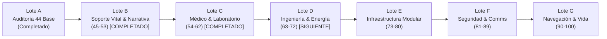

# Below Nominal — Hoja de Ruta de 100 Familias Procedurales (100 Asset Roadmap)

> **Documento de Planificación y Arquitectura de Producción.**
> Cumple con la Sección 15 del documento maestro `BELOW_NOMINAL_PLAN_100_MODELOS_PROCEDURALES.md`.
> **Ecosistema:** Blender 5.0 Headless → glTF 2.0 / GLB → Godot 4.3+ → Web Catálogo Astro.

---

## 1. Visión y Cronograma de Entregas por Lotes

La producción de las 100 familias se divide en **7 lotes funcionales** para garantizar que ningún lote avance sin pruebas unitarias completas, exportación validada y sincronización con el catálogo web.

---

## 2. Detalle de Lotes y Familias

### Lote A: Auditoría y Estandarización Base (44 Familias + 1 Comunitaria)
- **Objetivo:** Auditar, normalizar y validar que las 44 familias fundacionales cumplan con el contrato de manifiesto v1, colisión Godot y suite de pruebas.
- **Familias:** `station_corridor`, `station_room`, `autopsy_table`, `crash_cart`, `medical_screen`, `morgue_gurney`, `chemical_cabinet`, `restraint_chair`, `scrub_sink`, `oxypod`, `crew_bed`, `bunk_bed`, `nightstand`, `radiator_heater`, `office_door`, `mess_table`, `ration_automat`, `canteen_counter`, `locker_bench`, `space_toilet`, `work_bench`, `heavy_shelving`, `tool_chest_cart`, `safety_shower`, `hydroponic_tray_bed`, `electrical_panel`, `pipes`, `cable_bundle`, `vent_grate`, `crate`, `locker`, `security_desk`, `weapons_rack`, `bridge_console_desk`, `file_cabinet`, `terminal`, `server_rack`, `door`, `office_desk`, `office_chair`, `sign_placard`, `trash_bin`, `light_fixture`, `fire_extinguisher`, y `access_card_lvl1`.
- **Estado:** **100% Auditado y Certificado** (68/68 tests pasando en Blender 5.0).

---

### Lote B: Núcleo de Soporte Vital y Narrativa (Familias 45–53)
*Foco: Mecánica central de supervivencia (oxígeno, presión y almacenamiento de conciencia).*
- **Estado:** **100% Implementado, Validado y Sincronizado** (78/78 tests pasando en Blender 5.0, 54/54 modelos en catálogo web).

1. **`045. cryo_stasis_pod`**: Cápsula vertical de criostasis industrial con visor de escarcha y bisagras pesadas.
2. **`046. consciousness_archive`**: Banco de racks con cartuchos de memoria y refrigeración líquida.
3. **`047. neural_interface_chair`**: Silla de interfaz neuronal con electrodos low-poly y apoyacabezas.
4. **`048. memory_extraction_terminal`**: Consola con doble CRT, ranura de cartucho y dial analógico.
5. **`049. oxygen_regulator`**: Regulador mural con doble manómetro y válvulas de bronce.
6. **`050. oxygen_tank`**: Botella de oxígeno recargable para carritos, armarios y oxypods.
7. **`051. pressure_door_control`**: Panel numérico diegético con lector de presión bar/psi.
8. **`052. airlock_chamber`**: Módulo de esclusa completa con compuertas dobles y rejillas.
9. **`053. pressure_indicator`**: Indicador analógico circular con aguja de alerta.

---

### Lote C: Médico y Laboratorio (Familias 54–62)
*Foco: Bioseguridad, investigación y trajes de protección exterior.*
- **Estado:** **100% Implementado, Validado y Sincronizado** (88/88 tests pasando en Blender 5.0, 63/63 modelos en catálogo web).

1. **`054. suit_rack`**: Perchero reforzado para trajes EVA con perchas tubulares.
2. **`055. eva_suit_stand`**: Maniquí técnico independiente para ajuste de traje espacial.
3. **`056. helmet_storage`**: Armario con compartimentos cúbicos ventilados para cascos.
4. **`057. decon_chamber`**: Cabina de ducha desinfectante con boquillas a 3 niveles.
5. **`058. quarantine_bed`**: Cama de aislamiento con arcos y soportes de sujeción.
6. **`059. specimen_freezer`**: Congelador criogénico de muestras con cierre hermético.
7. **`060. biohazard_bin`**: Contenedor de residuos biológicos con pedal y bolsa visible.
8. **`061. surgical_light`**: Lámpara quirófano multi-reflector con brazo articulado.
9. **`062. microscope`**: Microscopio óptico facetado con torreta de 3 objetivos.

---

### Lote D: Ingeniería y Energía (Familias 63–72)
*Foco: Distribución eléctrica, reactores y análisis químico.*

1. **`063. lab_workstation`**: Mesa de análisis químico con fregadero y repisas reactivas.
2. **`064. sample_analyzer`**: Analizador de sobremesa con bandeja retráctil y leds.
3. **`065. chemical_drum`**: Tambor de reactivos químicos apilable con nervaduras.
4. **`066. coolant_pump`**: Bomba centrífuga de refrigeración con motor de aletas.
5. **`067. reactor_control_console`**: Consola masiva de control nuclear con palancas y diales.
6. **`068. power_transformer`**: Subestación transformadora con aisladores de cerámica.
7. **`069. fuse_box`**: Caja mural con fusibles cerámicos extraíbles.
8. **`070. battery_bank`**: Banco de acumulación energética con bornes de cobre.
9. **`071. generator_unit`**: Grupo electrógeno diésel/auxiliar encapsulado.
10. **`072. coolant_pipe_junction`**: Distribuidor de refrigerante en 3 y 4 vías con válvulas.

---

### Lote E: Infraestructura Modular (Familias 73–80)
*Foco: Conectividad estructural y logística de almacén.*

1. **`073. cable_tray`**: Bandeja perforada para tender cables por el techo.
2. **`074. overhead_pipe_support`**: Estructura de anclaje para colgar tubos de vigas.
3. **`075. floor_grating`**: Panel de suelo desmontable tipo pasarela de trinchera.
4. **`076. maintenance_hatch`**: Escotilla cuadrada/redonda para conductos de servicio.
5. **`077. ladder`**: Escalera fija vertical con jaula protectora antikaídas.
6. **`078. service_lift_door`**: Puerta reforzada de montacargas industrial.
7. **`079. cargo_pallet`**: Palé de transporte para manipulación de cajas y tambores.
8. **`080. cargo_container`**: Contenedor modular de almacenamiento con cantoneras de izaje.

---

### Lote F: Seguridad y Comunicaciones (Familias 81–89)
*Foco: Vigilancia de la estación, alarmas y transporte automatizado.*

1. **`081. conveyor_segment`**: Módulo recto o curvo de cinta transportadora de rodillos.
2. **`082. forklift_cart`**: Carretilla elevadora manual de palés.
3. **`083. security_camera`**: Cámara domo/caja con LED de grabación y visera.
4. **`084. access_card_reader`**: Lector mural de proximidad con ranura e indicador de acceso.
5. **`085. biometric_scanner`**: Escáner de huella/palma con luz láser y placa metálica.
6. **`086. alarm_siren`**: Bocina de advertencia rotativa con campana protectora.
7. **`087. speaker_intercom`**: Intercomunicador de pared de dos vías con rejilla perforada.
8. **`088. emergency_beacon`**: Luz estroboscópica de baliza ámbar/roja con jaula.
9. **`089. camera_monitor`**: Rack de pantallas CRT para monitoreo simultáneo CCTV.

---

### Lote G: Navegación y Habitabilidad (Familias 90–100)
*Foco: Vida a bordo, comunicaciones de largo alcance y soporte vital secundario.*

1. **`090. comms_antenna`**: Mástil de antenas dipolo para enlaces de radiofrecuencia.
2. **`091. antenna_dish`**: Parabólica orientable con alimentador focal para enlace orbital.
3. **`092. nav_console`**: Puesto de pilotaje y telemetría espacial con mandos analógicos.
4. **`093. star_chart_display`**: Pantalla mural de coordenadas de la órbita de Europa.
5. **`094. hydroponic_tank`**: Tanque translúcido de soluciones biológicas y sales.
6. **`095. nutrient_pump`**: Micro-bomba dosificadora para cultivos agrícolas.
7. **`096. water_recycler`**: Depurador de aguas grises con filtros de ósmosis.
8. **`097. food_storage_unit`**: Armario hermético para paquetes de raciones sintéticas.
9. **`098. crew_shower`**: Cabina de ducha individual con cortina industrial y grifo.
10. **`099. wall_clock`**: Reloj analógico militar de 24 horas para turnos de estación.
11. **`100. personal_effects_box`**: Baúl de recuerdos personales de la tripulación.

---

## 3. Protocolo de Validación Obligatorio por Cada Familia

Para cada generador nuevo o modificado se sigue rigurosamente el pipeline de 13 pasos:
1. **Auditoría de Requisitos:** Verificar unicidad de ID y ausencia de duplicados.
2. **Configuración Tipada:** Crear `config.py` heredando de `BaseAssetConfig` con tipado estricto.
3. **Manifiesto Formal:** Redactar `manifest.json` con etiquetas en español, sliders, grupos y al menos 2 presets.
4. **Construcción BMesh:** Implementar `generator.py` reutilizando primitivas de `MeshBuilder`.
5. **Mapeo al Atlas:** Asignar roles semánticos (`CASING`, `METAL`, `SCREEN`, `PANEL`, etc.) vinculados al atlas 256×256 con protección de medio texel.
6. **Verificación UV y Colores:** Auditoría obligatoria con capas `UVMap` y vertex colors `Col`.
7. **Compactación:** Limpieza de slots de materiales vacíos mediante `compact_materials(obj)`.
8. **Pivote y Normalización:** Configuración de pivote diegético (`floor_center`, `wall_back`, `center`) y horneado de transforms.
9. **Colisiones para Godot:** Generación automática de nodos `-convcolonly`.
10. **Exportación Dual:** Generar binario `.glb` y metadatos sidecar `.json`.
11. **Pruebas en Blender Headless:** Integrar test unitario en `tests/` comprobando determinismo y presets.
12. **Sincronización Web:** Actualizar `web/src/data/catalog.json` y generar modelo para visualización 3D.
13. **Inspección Visual:** Verificar proporciones y estética retro PSX (sin subdivisiones excesivas).
